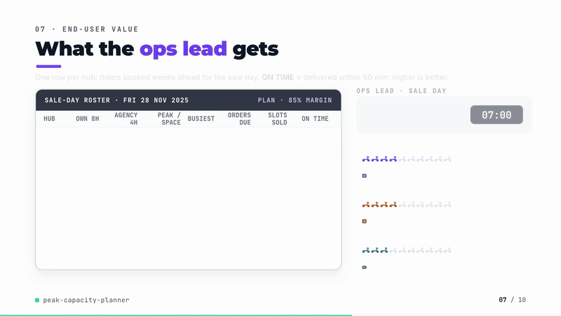
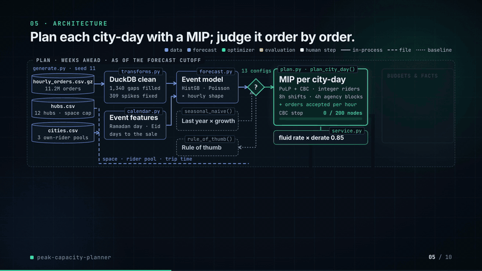

# peak-capacity-planner

[](https://github.com/kavya2693/peak-capacity-planner/actions/workflows/ci.yml)


How many delivery riders each grocery hub needs, on which shifts, and how many orders to accept
each hour, through Ramadan and a November mega-sale that brings four times a normal day's orders.
The plan comes from a mixed-integer program and is then checked order by order in a replay.

[](https://kavya2693.github.io/work-demos/peak-capacity-planner.mp4)

*90-second silent walkthrough. [Play the full video](https://kavya2693.github.io/work-demos/peak-capacity-planner.mp4) · [download the MP4, 6.4 MB](docs/demo/demo.mp4).*

📄 **Audit report:** every figure and assumption in the video, traced to its source — [PDF](docs/demo/AUDIT_REPORT.pdf) · [Word](docs/demo/AUDIT_REPORT.docx) · [Markdown](docs/demo/AUDIT_REPORT.md)

## At a glance

| | |
|---|---|
| **Problem** | Commit riders and agency blocks for 12 hubs weeks ahead of Ramadan, Eid and a 4.2x mega-sale, against a forecast, with a one-hour delivery promise. |
| **Approach** | Event-aware demand forecast, a per-city-day MIP (PuLP + CBC) for shifts and hourly slot caps, and an order-by-order replay against true demand that judges every plan. |
| **Result** | Against last season's playbook over 51 peak days: 17.6% less rider cost, 6.4% less total cost including lost margin, on-time for accepted orders up from 76.9% to 98.9%. |
| **What didn't win** | No plan reaches 99% on time without turning customers away; the 99.9% version refuses 9.4% of customers and costs 1.03M AED more. On the sale day the model's daily forecast (11.6% WAPE, 11.6% under) loses to last year's figure (8.6%). |

## Architecture

```mermaid
flowchart LR
    subgraph SRC["Sources"]
        hourly[("hourly_orders.csv.gz<br/>scripts/generate_data.py")]
        static[("hubs.csv · cities.csv<br/>trip minutes, space, rider pool")]
        cal["Event calendar<br/>calendar.py · config.py"]
    end

    subgraph DATA["Data and features"]
        clean["Feed cleaning in DuckDB SQL<br/>transforms.clean"]
        daily[("Cleaned hub-hours and hub-days<br/>transforms.daily_orders")]
        prof["Hourly shape per kind of day<br/>transforms.hourly_profiles"]
    end

    subgraph MOD["Models"]
        em["Event model, HistGB Poisson<br/>forecast.event_model"]
        naive["Seasonal naive baseline<br/>forecast.seasonal_naive"]
        rate["Fluid rider rate, iftar traffic<br/>service.py"]
    end

    subgraph DEC["Decision"]
        orch["13 configurations, 1,989 city-day plans<br/>experiment.py · cli.py"]
        mip["City-day MIP, PuLP + CBC<br/>plan.plan_city_day"]
        rot["Rule of thumb<br/>plan.rule_of_thumb"]
    end

    subgraph EVAL["Evaluation"]
        replay["Order replay on true demand<br/>replay.replay_hub_day"]
        acc["Forecast WAPE and bias by slice<br/>forecast.accuracy"]
        erlang["Erlang C check on the dispatcher<br/>tests/test_replay.py"]
    end

    subgraph OUT["Outputs"]
        res[("results/*.csv · summary.json")]
        rep["run_report.md<br/>report.py"]
    end

    hourly -->|"orders_recorded"| clean
    cal -->|"regime, event_day"| clean
    clean --> daily
    daily -->|"days before cutoff"| em
    daily --> naive
    daily --> prof
    prof -->|"hour shares"| em
    cal -->|"days to Eid, sale"| em
    em -->|"hourly forecast"| orch
    naive -.->|"comparison arm"| orch
    hourly -.->|"true demand, oracle arm"| orch
    static --> orch
    rate -->|"orders per rider-hour"| mip
    orch -->|"city-day task"| mip
    orch -->|"city-day task"| rot
    mip -->|"roster + slot caps"| replay
    rot -->|"roster"| replay
    hourly -->|"true demand"| replay
    em --> acc
    naive --> acc
    replay -->|"hub_day rows"| res
    acc --> res
    res --> rep
    erlang -.->|"validates"| replay
    replay -.->|"plan-to-replay gap sets derate 0.85"| mip

    classDef data fill:#7fa8ff,stroke:#3b5bab,color:#0b1020
    classDef models fill:#b9a2ff,stroke:#6a4fc4,color:#0b1020
    classDef decision fill:#3fd8a8,stroke:#1d8a68,color:#0b1020
    classDef evaluation fill:#f2c46d,stroke:#a67c22,color:#0b1020
    classDef risk fill:#ff8a73,stroke:#b2462f,color:#0b1020
    class hourly,static,cal,clean,daily,prof,res,rep data
    class em,naive,rate models
    class orch,mip decision
    class replay,acc,erlang evaluation
    class rot risk
```





Blue is data, violet the models, green the decision layer, amber the evaluation, and red the
baseline the plan has to beat. Dotted edges are the comparison arms and the one feedback loop:
the derate is chosen from the gap between planned and replayed on-time, not assumed.

### Components

| Component | Responsibility | File |
|---|---|---|
| Data generator | Seeded three-year hourly order history, hub and city tables, feed defects | [`scripts/generate_data.py`](scripts/generate_data.py), [`generate.py`](src/peak_capacity/generate.py) |
| Event calendar | Ramadan, Eid, sale and national-day features counted from the event, not the date | [`calendar.py`](src/peak_capacity/calendar.py), [`config.py`](src/peak_capacity/config.py) |
| Feed cleaning | Fill gaps, replace spikes, flag closures with SQL windows per hub, hour and kind of day | [`transforms.py`](src/peak_capacity/transforms.py) |
| Forecasters | Event model on ratio to hub level, seasonal naive baseline, accuracy by slice | [`forecast.py`](src/peak_capacity/forecast.py) |
| Rider rate | Orders per rider-hour from trip time and iftar traffic, shared by planner and replay | [`service.py`](src/peak_capacity/service.py) |
| Planner | City-day MIP over shifts, agency blocks and hourly acceptance; rule-of-thumb baseline | [`plan.py`](src/peak_capacity/plan.py) |
| Order replay | Minute-level arrivals, lognormal trips, no-shows, FIFO dispatch, 60-minute promise | [`replay.py`](src/peak_capacity/replay.py) |
| Experiment runner | Builds 13 configurations, solves city-days in a process pool, replays, aggregates | [`experiment.py`](src/peak_capacity/experiment.py), [`cli.py`](src/peak_capacity/cli.py) |
| Reporting | Writes `results/*.csv`, `summary.json` and `run_report.md` | [`report.py`](src/peak_capacity/report.py) |

### Design decisions

Full reasoning in [ADR-0001](docs/adr/0001-plan-with-a-fluid-mip-judge-with-an-order-replay.md).

| Decision | Options considered | Chosen | Trade-off |
|---|---|---|---|
| How to forecast moving events | Same day last year; event-relative features | Gradient-boosted ratio to the hub's recent level, features counted from the event | Wins every Ramadan slice; cannot extrapolate a sale that grows each year (11.6% under on the sale day) |
| Capacity inside the optimiser | Erlang C (non-linear); stochastic programming over scenarios; fluid rate with a derate | Fluid rate x one derate (0.85) measured in the replay | Linear and fast; one number over-staffs quiet hours to protect busy ones |
| Planning unit | Each hub alone; each city-day | City-day, sharing the own-rider pool across its hubs | No double-booked riders; pool is checked per day, not per week |
| How plans are judged | The planner's own on-time; an independent order replay | Replay that shares only roster, slot caps and mean trip time with the planner | Exposes the queueing gap; costs a second model of the operation, tested against Erlang C first |
| Slot caps on the storefront | Sell up to the derated rate; sell up to flat-out throughput | Flat-out, with derated caps kept as an ablation | About one point of on-time traded for half the turned-away customers (4.8% vs 9.4%) |
| Solver stopping rule | Wall-clock limit; node limit | 0.5% gap or 200 nodes per city-day, 20 CPU seconds as backstop | Repeatable plans; cost differences under 0.5% are noise |

### Data contracts

| Stage | Key fields (type) | Grain |
|---|---|---|
| `hourly_orders.csv.gz` | `date` (date), `hub`, `city` (str), `op_hour`, `clock_hour` (int), `orders` (int, true demand), `orders_recorded` (float, nullable) | hub x day x operating hour, 07:00 to 03:00 |
| `hubs.csv` / `cities.csv` | `hub`, `city` (str), `base_daily` (int), `trip_minutes` (float), `max_on_duty` (int) / `city`, `own_pool` (int) | one row per hub / city |
| Cleaned feed | `orders_clean` (float), `regime` (str), `event_day`, `was_gap`, `was_spike`, `outage` (bool) | hub x day x hour |
| Forecast | `date`, `hub`, `city`, `op_hour`, `forecast` (float) | hub x day x hour, as of the window cutoff |
| Plan | `own` / `gig` (start hour -> riders), `riders` and `slot_cap` per hour (array), planned `accepted`, `on_time`, `lost`, `rider_cost`, solver `status` | hub x day, solved per city-day |
| `results/hub_day.csv` | config columns, `solver_status`, `own_riders`, `gig_blocks`, `rider_cost`, planned vs replayed `accepted`, `lost`, `on_time`, `late`, `undelivered`, `p90_minutes` | configuration x hub x day |

### Failure modes and fallbacks

| Condition | What the code does |
|---|---|
| Missing hub-hours in the feed | Filled with the hour's expected share of its own day (1,340 filled in the run). |
| Duplicated-event spike | An hour 4 sigma above what the rest of its day implies is replaced with the expected count. Over-flags: 309 replaced, three of them planted. |
| Hub closure | A day below 30% of the hub's trailing 28-day median is flagged and kept out of the hub level, the training rows and the hourly shapes. |
| Data arriving after the cutoff | Never read: the forecast is made as of the cutoff, tested by zeroing everything after it. The cleaning window is centred, so hours within two weeks of the cutoff see a little future data (listed limitation). |
| Forecast under-calls demand | No automatic fallback. Slot caps turn the excess into turned-away customers rather than late orders; the seasonal naive forecast runs alongside as a comparison arm and accuracy is reported per slice. The sale-day under-forecast is listed in Known limitations. |
| Solver does not prove the gap | CBC returns its best plan at 200 nodes or 20 CPU seconds; the status is kept per hub-day in `solver_status` (1-19% of city-days per configuration). Every city-day is feasible by construction, since accepting no orders satisfies every constraint. |
| Riders do not show up | Not hedged in the plan beyond the derate; the replay applies 3% own and 8% agency no-shows, so the cost shows up in the replayed on-time share. |

### Path to production

This is a mapping of each local piece to a managed equivalent, not a deployed system.

| Local, in this repo | Production equivalent |
|---|---|
| Seeded CSVs in `data/` | Order-event table in a warehouse (BigQuery, Snowflake), partitioned by date and hub |
| DuckDB cleaning SQL | The same SQL as a scheduled dbt model on the warehouse |
| HistGradientBoosting fitted in-process at each cutoff | Training job per planning cutoff (Vertex AI, SageMaker), model registry, versioned features |
| PuLP + CBC in a local process pool | Containerised solver fan-out per city-day (Cloud Run jobs, AWS Batch); HiGHS or a commercial solver if runtime binds |
| `make run` | Orchestrated DAG (Airflow, Step Functions) run weekly from the forecast cutoff to the window |
| `results/*.csv` and `run_report.md` | Planning tables feeding the roster tool and an operations dashboard |
| Order replay | Nightly backtest of the committed plan against actual order and delivery timestamps |

Monitoring would track the same numbers the repo reports: daily and hourly WAPE and bias per
slice against the seasonal naive forecast, the gap between planned and replayed on-time (the
signal to re-estimate the derate), the turned-away share, and the share of city-days where the
solver stopped short of the gap. Retraining is already per cutoff; in production it would run
at each planning cutoff and whenever forecast bias on a slice drifts past a set band.

## The problem

A grocery delivery operator runs 12 hubs across three cities and promises delivery within an
hour. On an ordinary weekday the hubs order about 10,000 deliveries between them and the
roster copes. Twice a year it does not. In Ramadan, orders shift into the hours before iftar
and after midnight and climb through the last ten nights. On the last Friday of November a
mega-sale brings 4.2 times an ordinary weekday's orders across the network, with the busiest
hour at 3.9 times a normal peak.

The staffing plan for those weeks is usually last season's spreadsheet: take the forecast for
the day, divide by what a rider delivers in a shift at an assumed utilisation, spread the
riders over three shift starts, and book agency riders for the evening if the own fleet runs
short. Every rider-hour costs money, and every order delivered late or turned away costs a
customer. The operations lead has to commit riders and agency blocks weeks ahead, against a
forecast, and is judged on the on-time share afterwards.

## Why it is hard

Three things break the spreadsheet. **The dates move.** Ramadan starts about eleven days
earlier every Gregorian year, so "same day last year" reads the 25th night of Ramadan 2025 from
the 16th night of 2024. **Averages lie about queues.** A plan that has exactly enough rider
throughput for each hour still makes orders wait, because trips are random and orders do not
arrive evenly; the busier the hub, the worse it gets. **Space runs out.** On the sale day the
hubs physically cannot hold enough riders, and the only remaining lever is how many orders the
storefront accepts. That lever can make the on-time share look as good as you like by turning
customers away, so the on-time share alone cannot judge a plan.

## The approach

Demand is forecast per hub and day as a multiple of the hub's recent ordinary level, with
features counted from the events themselves (day of Ramadan, days to Eid, days to the sale),
then split into hours by the shape of that kind of day. For each city and day a MIP in PuLP
(CBC) chooses own-rider 8-hour shifts and agency 4-hour blocks per hub, plus how many orders
each hour accepts, subject to the city's own-rider pool, each hub's space, and an on-time
target per hub-day, at minimum rider cost plus the margin lost on turned-away orders. A
separate order-level replay then plays each plan against the true demand: random arrival
minutes, lognormal trips, rider no-shows, slower traffic before iftar, and a one-hour promise.

The key decision, recorded in
[ADR-0001](docs/adr/0001-plan-with-a-fluid-mip-judge-with-an-order-replay.md), is to treat the
gap between the planned and the replayed on-time share as something to measure rather than
assume, close it with a single capacity derate chosen from the replay, and always report a
second on-time number, **on-time share of everyone who tried to order**, which closing slots
cannot flatter.

## The result

Two peak windows in 2025: Ramadan and Eid (24 February to 3 April, forecast as of 31 January)
and the mega-sale fortnight (20 November to 1 December, forecast as of 31 October). 12 hubs,
612 hub-days, 754,577 customers. Every number below is in [`results/`](results/) and comes
from `make run`; costs are AED over the whole 51 days.

**Plans at a 99% on-time target.** "On time" = delivered within 60 minutes of ordering, as
played out in the replay. "Turned away" = customers who found the hour sold out and did not
retry.

| Plan | Rider cost | Lost margin | Total cost | On time, accepted orders | On time, all customers | Turned away | Hub-days below 99% |
|---|---|---|---|---|---|---|---|
| Rule of thumb (last season's playbook) | 9.73M | 0 | 9.73M | 76.9% | 76.9% | 0% | 99.8% |
| MIP, fluid capacity (derate 1.0) | 7.19M | 1.56M | 8.74M | 96.4% | 89.8% | 6.9% | 54.2% |
| **MIP, derate 0.85** | **8.02M** | **1.09M** | **9.11M** | **98.9%** | **94.1%** | **4.8%** | **26.3%** |
| MIP, derate 0.85, slots sold at the derated rate | 8.02M | 2.12M | 10.13M | 99.9% | 90.6% | 9.4% | 1.6% |
| MIP, derate 0.85, seasonal-naive forecast | 7.84M | 2.20M | 10.04M | 97.5% | 88.0% | 9.7% | 50.9% |
| MIP, derate 0.85, perfect forecast | 7.93M | 0.88M | 8.82M | 99.6% | 95.7% | 3.9% | 9.6% |
| MIP, derate 1.0, perfect forecast | 7.05M | 1.01M | 8.05M | 95.0% | 90.8% | 4.4% | 78.2% |

Against the rule of thumb, the derated MIP spends 17.6% less on riders, costs 6.4% less in total
including lost margin (12.74 vs 14.57 AED per delivered order), and lifts on-time from 76.9% to
98.9% of accepted orders. The rule of thumb over-staffs ordinary days and collapses on the sale
day, where it puts a third of its riders on at 07:00 and the opening burst never clears.

**The metric that disagrees.** No plan reaches 99% on time for accepted orders without
turning customers away. The bold row misses 99% by a tenth of a point; selling slots
only up to the derated rate gets to 99.9%, but turns away twice as many customers (9.4% against
4.8%), lowers the on-time share of all customers from 94.1% to 90.6%, and costs 1.03M more, all
of it in lost margin. A "99% on time" headline on a 4x day is available, and this is what it
costs.

**Where the plan-to-replay gap comes from.** Even with the true demand handed to the planner,
a plan built at the fluid rate (rider delivers 60 / trip-minutes orders per hour, every hour)
replays at 95.0%, and 78% of its hub-days miss the target. The queueing gap is bigger than the
forecast gap. Derating throughput to 85% closes most of it (99.6% with a perfect forecast,
98.9% with the model's forecast).

**What the forecast is worth.** Forecast quality shows up mainly as turned-away customers,
because the slot caps absorb demand the roster was not sized for. With the seasonal-naive
forecast the same planner turns away 9.7% of customers instead of 4.8%, and total cost is 0.93M
higher. A perfect forecast would save another 0.29M; the model captures 76% of the gap between
naive and perfect.

**Forecast accuracy** (hourly and daily WAPE against true demand; bias = forecast / actual - 1):

| Window slice | Hub-days | Model daily WAPE | Naive daily WAPE | Model hourly WAPE | Naive hourly WAPE | Model bias | Naive bias |
|---|---|---|---|---|---|---|---|
| Before Ramadan | 60 | 6.8% | 12.5% | 19.4% | 27.3% | +2.2% | -10.9% |
| Ramadan, days 1-19 | 228 | 7.2% | 10.9% | 19.0% | 41.4% | +1.4% | -3.5% |
| Ramadan, last ten nights | 84 | 7.1% | 15.6% | 19.3% | 27.6% | -0.9% | -14.5% |
| Eid al-Fitr, eve to fourth day | 96 | 8.5% | 43.9% | 19.7% | 60.2% | +2.8% | +21.0% |
| Sale week | 132 | 7.5% | 11.2% | 18.1% | 25.6% | +0.6% | +1.0% |
| **Sale day** | 12 | **11.6%** | **8.6%** | 17.7% | 22.9% | **-11.6%** | -7.2% |

The model wins every Ramadan slice because it knows which night of Ramadan it is. It loses the
sale day's daily total to last year's figure: the sale grows every year, and a model that learns
"sale day = x times the level" from two past sales under-forecasts a third, bigger one by 11.6%.
Hourly WAPE floors near 18% for both because hourly counts are noisy at hub level.

**The cost of raising the on-time target** (derate 0.85, slots sold at the flat-out rate):

| Target in the plan | Rider cost | Total cost | Extra cost vs previous step | On time, accepted | On time, all customers | Turned away |
|---|---|---|---|---|---|---|
| 95% | 7.97M | 8.90M | | 97.4% | 93.4% | 4.1% |
| 97% | 7.95M | 9.00M | +0.10M | 98.4% | 93.8% | 4.6% |
| 99% | 8.02M | 9.11M | +0.11M | 98.9% | 94.1% | 4.8% |
| 99.5% | 8.04M | 9.13M | +0.02M | 98.9% | 94.2% | 4.8% |
| 99%, derated slots | 8.02M | 10.13M | +1.03M | 99.9% | 90.6% | 9.4% |

From 95% to 99% the target costs 0.21M (2.3%) and buys 1.5 points of replayed on-time. Beyond
99% the planner has nothing left to buy inside the hub-space limit: 99.5% costs almost the same
and replays the same, and the remaining point only comes from closing slots. At derate 1.0 the
same curve sits 2.3 to 6.7 points lower on on-time at every target (90.7% to 96.7%), which is
what assuming the fluid rate costs ([`results/tradeoff.csv`](results/tradeoff.csv)).

**The sale day itself** (12 hub-days): the derated MIP delivers 95.9% of accepted orders on
time and turns away 7.1% of customers; 6 of 12 hubs miss 99%. That is the hardest day of the
year and the forecast under-called it by 11.6%. The rule of thumb's 2.2% on time that day is a
backlog that never clears in a replay with no cancellations; read it as "collapsed", not as a
precise figure.

## How it works

```
hourly_orders.csv.gz ──► DuckDB cleaning: fill feed gaps, replace duplicate spikes,
hubs.csv, cities.csv       flag closures (window medians per hub, hour, kind of day)
                                 │
                                 ▼
               forecast as of the cutoff (no data after it)
       event model: HistGradientBoosting (Poisson) on ratio to hub level
       naive: same weekday 52 weeks earlier x year-on-year growth
                                 │  hourly demand per hub
                                 ▼
          per city-day MIP (PuLP + CBC), 13 configurations
   x own 8h shifts, agency 4h blocks (integer)    acc, on-time, late, backlog, spill (hourly)
   riders on duty <= hub space     own riders <= city pool     on-time >= target x accepted
   min  rider cost + 30 AED x lost orders
                                 │  roster + slot caps
                                 ▼
     order replay on TRUE demand: Poisson-in-hour arrivals, slot caps with 70% retry,
     6 min pick, FIFO to the first free on-duty rider, lognormal trips (CV 0.35),
     iftar traffic x1.25, 3% / 8% no-shows, promise = 60 min from order
                                 │
                                 ▼
     results/: plan_summary, by_segment, tradeoff, forecast_accuracy, hub_day
```

Stop conditions: CBC stops at a 0.5% optimality gap or 200 branch-and-bound nodes per city-day
(20 CPU seconds as a backstop). The node limit makes reruns repeatable; the CPU backstop
occasionally fires on a busy machine, and two full runs differed in three configurations by
under 0.01% of cost, below every figure quoted here. 1-19% of city-days per
configuration had a plan that stopped on the node limit rather than proving the gap (`solver_status` in
`results/hub_day.csv`). In the replay a rider never starts a trip after the shift ends, the
storefront stops taking orders 15 minutes before the 03:00 close, and an order nobody could
take before close counts as not delivered.

## Running it

```bash
uv sync
make data      # 12 hubs, 3 cities, 2023-2025, 263,040 hub-hours, 11.2M orders (seed 11)
make run       # forecast, 1,989 city-day plans, replay -> results/ (about 2 min on a quiet machine)
make check     # ruff, ruff format, mypy, pytest
uv run peak-capacity --quick --out results-ci   # 3 peak days per window, 3 plans, as CI runs it
docker build -t peak-capacity-planner . && docker run --rm peak-capacity-planner
```

`results/run_report.md` has every table; `results/run_log.txt` is the console output of the
run quoted here.

## The data

The dataset is generated by the seeded script `scripts/generate_data.py` and sized to the
production problem (12 hubs, three years of hourly orders, about 11.2 million orders);
production order data is proprietary.

It carries the patterns that matter for peak planning: 16% annual growth; a weekly cycle;
Ramadan on its real 2023-2025 dates with the pre-iftar peak, the iftar collapse and the
late-night surge, rising into the last ten nights; the Eid eve spike and quiet Eid days; Eid
al-Adha; a pre-Ramadan stock-up; a summer dip; national day; two rain days a year per city;
a mega-sale on the last Friday of November that grows from 3.3x to 3.8x the day's base across
the three years, with a ramp-up week and a tail. Hour counts are over-dispersed (gamma-Poisson).
The recorded feed has 0.5% missing hub-hours, one three-hour duplicated-event spike and a two-day
hub closure; the cleaning step filled 1,340 gaps, flagged the closure, and replaced 309 hours as
spikes, the planted three among them and the rest high-noise hours it should have left alone.
Trip times are a per-hub mean with lognormal noise, not a road network.

## Tests

`make check` runs 17 tests. The two that matter most:

- `test_dispatch_matches_erlang_c_waiting_probabilities` feeds the replay's dispatcher Poisson
  arrivals and exponential trips with 10 riders at 80% utilisation and checks the share of
  orders that wait, and that wait more than ten minutes, against the Erlang C formula. The
  replay is the yardstick for every plan, so it was checked against queueing theory before any
  plan was scored with it.
- `test_event_model_beats_last_year_on_ramadan_and_never_peeks_past_cutoff` zeroes every
  record after the forecast cutoff and checks the forecast does not change, then checks the
  model beats the seasonal naive forecast on the last ten nights and on Eid.

## Known limitations

- **The biggest gap: the derate is one number.** One 0.85 for every hub and hour over-staffs
  quiet hours to protect busy ones; the queueing gap really depends on utilisation and rider
  count. A derate that falls with utilisation, or an Erlang-based capacity curve linearised
  into the MIP, would buy the same on-time share for less.
- **The sale is under-forecast and nothing in the plan hedges it.** The model trained on two
  past sales cannot extrapolate a growing third one. A planner would add a judgement uplift; a
  scenario-based plan (stochastic programming over sale intensity) is the principled version.
- The replay has no cancellations. A hub that falls behind stays behind, which is why the rule
  of thumb's sale day reads 2.2% on time. Real customers cancel, which frees riders and would
  change both the on-time and the lost numbers on days that collapse.
- Riders return to the hub after every order; there is no batching of two orders into one trip.
  Batching would raise throughput on exactly the peak days.
- The own-rider pool is checked per day, not per week; a rider working six days in a row is
  assumed, not scheduled.
- The feed cleaning uses a centred 29-day window, so hours within two weeks of a cutoff are
  cleaned with a little future data. The forecast itself never reads past its cutoff (tested).
- Cost differences under 0.5% between configurations are inside the solver gap.
- Docker builds and runs only in CI; the local Docker daemon was unavailable.

## Insights and learning

I picked this because peak-season staffing is usually argued from one number, the on-time
share, and that number can be bought in two very different ways: with riders or by closing
slots. I wanted a setup that separates the two, and the second on-time metric (share of
everyone who tried to order) did that immediately.

What surprised me was how much of the gap between plan and reality was queueing rather than
forecasting. Handing the fluid planner the true demand did not raise replayed on-time at all:
it fell from 96.4% to 95.0%, because a plan sized exactly to demand runs riders at the edge. Derating
rider throughput by 15% did more than a perfect forecast would.

What I got wrong first: I let the storefront sell each hour only up to the derated capacity.
The replay came back at 99.9% on time, which looked like the result I wanted, until the
turned-away share showed one customer in nine being refused on Ramadan days. Selling up to the
flat-out rate and letting the queue absorb the variance roughly halved the turned-away share
overall (9.4% to 4.8%) for one point of on-time. That ablation is kept in the results table. I also first stopped CBC on a
wall-clock limit, which on a busy machine returned different plans on each run; it now stops
on a node count.

Next I would make the derate depend on utilisation, plan the sale day over intensity scenarios
instead of one forecast, and add two-order batching to the replay.

## License

MIT
