# peak-capacity-planner: demo video audit report

**Repository:** https://github.com/kavya2693/peak-capacity-planner  
**Numbers taken from commit:** `e7248d7` (outputs last changed in `e7248d7 (2026-10-14 11:28:26 +0400)`)  
**Video:** `docs/demo/demo.mp4` (89.8 s, 1920x1080, 30 fps, silent)  
**Generated:** 2026-10-14 18:57  
**Automated checks:** 73 pass · 0 fail · 4 manual (of 77 figures)

## How to use this report

Every number or claim on screen has an ID (`F-01`, `F-02`, ...) and every modelling assumption has an ID (`A-01`, ...). Cite the ID. Each figure lists its source file, the exact column/row/key, the formula for derived numbers, and an automated check result. The change-impact matrix tells you which slides and files change if an input or assumption changes.

Types: **direct** = read straight from a repo output; **derived** = computed from direct values (formula given); **illustrative** = drawing or example, not data; **general knowledge** = context not produced by the repo.

### Regenerate

```bash
make run                                   # data/ (seed 11) and results/*.csv, summary.json, run_log.txt (~3 min)
.venv/bin/python docs/demo/source/tools/export_series.py docs/demo/source/assets/run_series.json
.venv/bin/python docs/demo/source/tools/export_roster.py docs/demo/source/assets/sale_day_roster.json
python3 docs/demo/source/tools/inject_sheet.py docs/demo/source/assets/run_series.json docs/demo/source/compositions/s04-routes.html --marker SERIES
python3 docs/demo/source/tools/inject_sheet.py docs/demo/source/assets/sale_day_roster.json docs/demo/source/compositions/value.html --marker SHEET --rows A1,A2,A4,B1,B2,C1 --animate A1,B2,C1
python3 docs/demo/source/tools/inject_sheet.py docs/demo/source/assets/sale_day_roster.json docs/demo/source/compositions/s07-end.html --marker SALE
cd docs/demo/source && npx --yes hyperframes@0.8.156 check && npx --yes hyperframes@0.8.156 render -f 30 -q looks -o renders/peak-capacity-planner-master.mp4 && cd -
ffmpeg -y -i docs/demo/source/renders/peak-capacity-planner-master.mp4 -c:v libx264 -preset slow -crf 25 -pix_fmt yuv420p -movflags +faststart -an docs/demo/demo.mp4
python3 docs/demo/source/tools/build_audit_report.py docs/demo/source/audit/facts.yaml   # stills, checks, MD/DOCX/PDF
```

## 1. Figures

| ID | Shown on screen | Slides | Source | Column / row / key | How computed | Type | Check |
|---|---|---|---|---|---|---|---|
| F-01 | 3 industry chips | 01 | `author's framing` | - | - | general knowledge | manual: Context statement, not a repo output. |
| F-02 | 4 problem cards | 01 | `README 'The problem', 'Why it is hard'` | README lines 22-31 | - | general knowledge | ✓ verified |
| F-03 | 12 hubs | 02, 05, 06, 08 | `data/hubs.csv` | row count | - | direct | ✓ verified |
| F-04 | 3 cities / 3 own-rider pools | 02, 05 | `data/cities.csv` | row count | - | direct | ✓ verified |
| F-05 | Sale day: 4.2× the orders | 02 | `data/hourly_orders.csv.gz` | orders on 2025-11-28 / mean Mon-Fri daily orders 2025-09-01..11-14 | 49,134 / 11,696 = 4.20 | derived | ✓ verified |
| F-06 | On time = delivered within 60 minutes of the order / promise 60 min | 02, 05 | `src/peak_capacity/config.py:17` | PROMISE_MINUTES | - | direct | ✓ verified |
| F-07 | busiest hour 3.9× a normal peak | 02 | `data/hourly_orders.csv.gz` | max hourly orders 2025-11-28 / max over hours of the mean ordinary-weekday hourly orders | 3.87, rounded | derived | ✓ verified |
| F-08 | Ramadan moves ~11 days a year | 02 | `src/peak_capacity/config.py:81-86 (RAMADAN)` | first-day dates 2023-2026 | mean shift between consecutive years = (12 + 10 + 11) / 3 = 11 days | derived | ✓ verified |
| F-81 | 51 peak days planned | 02 | `results/hub_day.csv` | distinct date | - | direct | ✓ verified |
| F-82 | Peak = Ramadan, Eid and a November mega-sale | 02 | `src/peak_capacity/config.py (WINDOWS); README 'The result'` | two windows | - | direct | ✓ verified |
| F-09 | ✓ more on time ✓ lower rider cost ✓ lower total cost | 03 | `results/summary.json` | replay_otd, rider_cost, total_cost | mip_t99_d85 better than rule_of_thumb on all three | derived | ✓ verified |
| F-10 | 3 years, hour by hour | 03 | `data/hourly_orders.csv.gz` | date years, op_hour | distinct years = 2023, 2024, 2025 | direct | ✓ verified |
| F-11 | 85% / 0.85 margin / margin 0.85 / 85% margin / riders at 85% | 04, 05, 06, 07 | `src/peak_capacity/experiment.py:64` | Config('mip_t99_d85', ..., 0.85) | - | direct | ✓ verified |
| F-12 | 95.0% | 04 | `results/plan_summary.csv` | config=mip_t99_d100_oracle, replay_otd | x 100, 1 dp | direct | ✓ verified |
| F-13 | 99.6% | 04 | `results/plan_summary.csv` | config=mip_t99_d85_oracle, replay_otd | x 100, 1 dp | direct | ✓ verified |
| F-14 | WITH A 15% MARGIN | 04 | `src/peak_capacity/experiment.py:64` | derate 0.85 | 1 - 0.85 = 15% | derived | manual: Arithmetic on F-11 (checked there). |
| F-15 | 11.2M orders | 05 | `data/hourly_orders.csv.gz` | sum(orders) | 11,198,428 / 1e6, 1 dp | direct | ✓ verified |
| F-16 | generate.py seed 11 | 05 | `scripts/generate_data.py:14` | --seed default | - | direct | ✓ verified |
| F-17 | 1,340 gaps filled | 05 | `results/cleaning.csv` | gaps_filled | - | direct | ✓ verified |
| F-18 | 309 spikes fixed | 05 | `results/cleaning.csv` | spikes_replaced | - | direct | ✓ verified |
| F-19 | gradient boosting | 05 | `src/peak_capacity/forecast.py:71-72` | HistGradientBoostingRegressor(loss='poisson') | - | direct | ✓ verified |
| F-20 | 13 configs / configurations 13 | 05 | `results/plan_summary.csv` | row count | - | direct | ✓ verified |
| F-21 | 1,989 | 05, 10 | `results/run_log.txt` | 'solving 1989 city-day plans' | - | direct | ✓ verified |
| F-22 | solver gap 0.5% | 05 | `src/peak_capacity/plan.py:129` | gapRel=0.005 | - | direct | ✓ verified |
| F-23 | 200 / 200 nodes | 05 | `src/peak_capacity/plan.py:82` | max_nodes: int = 200 | - | direct | ✓ verified |
| F-24 | time backstop 20 s | 05 | `src/peak_capacity/plan.py:83` | time_limit: int = 20 | - | direct | ✓ verified |
| F-25 | full run 179 s / ~3 min | 05, 10 | `results/run_log.txt` | '[  179.3s] done' | 179.3 s, rounded; ~3 min on slide 10 | direct | ✓ verified |
| F-26 | hubs open 07–03 | 05 | `src/peak_capacity/config.py:14-15` | OPEN_CLOCK_HOUR = 7, N_HOURS = 20 | 07:00 + 20 h = 03:00 | derived | ✓ verified |
| F-27 | 7,956 hub-days | 05 | `results/hub_day.csv` | row count | 13 configs x 612 hub-days | direct | ✓ verified |
| F-28 | ✓ checked vs queue maths | 05 | `tests/test_replay.py:20` | test_dispatch_matches_erlang_c_waiting_probabilities | - | direct | ✓ verified |
| F-29 | Pick the margin · from the replay, not assumed · margin 0.85 | 05 | `docs/adr/0001-plan-with-a-fluid-mip-judge-with-an-order-replay.md` | Decision bullet 4 | - | direct | ✓ verified |
| F-30 | 8h shifts · 4h agency blocks | 05 | `src/peak_capacity/config.py:53, :55` | OWN_SHIFT_HOURS, GIG_BLOCK_HOURS | - | direct | ✓ verified |
| F-31 | transforms.py, calendar.py, forecast.py, seasonal_naive(), rule_of_thumb(), plan.py · plan_city_day(), service.py, experiment.py, replay.py, generate.py | 05 | `src/peak_capacity/` | def names | - | direct | ✓ verified |
| F-34 | 51 peak days | 06 | `results/hub_day.csv` | distinct date | 39 Ramadan-window days + 12 sale-window days | direct | ✓ verified |
| F-35 | three daily on-time lines | 06 | `results/hub_day.csv -> demo:assets/run_series.json -> s04-routes.html` | sum(on_time)/sum(accepted) per date and config | - | derived | ✓ verified |
| F-36 | 76.9% | 06, 08 | `results/plan_summary.csv` | config=rule_of_thumb, replay_otd | x 100 | direct | ✓ verified |
| F-37 | 96.4% | 06 | `results/plan_summary.csv` | config=mip_t99_d100, replay_otd | x 100 | direct | ✓ verified |
| F-38 | 98.9% | 06, 08 | `results/plan_summary.csv` | config=mip_t99_d85, replay_otd | x 100 | direct | ✓ verified |
| F-39 | sale day: rule of thumb 2.2% | 06 | `results/hub_day.csv` | config=rule_of_thumb, segment=sale_day | sum(on_time)/sum(accepted) | derived | ✓ verified |
| F-40 | target 99% | 06 | `src/peak_capacity/experiment.py:64` | target 0.99 | - | direct | manual: Same Config line as F-11 (checked there). |
| F-41 | 98.9% | 06 | `results/plan_summary.csv` | mip_t99_d85 replay_otd | x 100 | direct | ✓ verified |
| F-42 | 94.1% | 06, 09 | `results/plan_summary.csv` | mip_t99_d85 served_on_time_share | x 100 | direct | ✓ verified |
| F-43 | 4.8% | 06, 09 | `results/plan_summary.csv` | mip_t99_d85 lost_share | x 100 | direct | ✓ verified |
| F-44 | 99.9% | 06 | `results/plan_summary.csv` | mip_t99_d85_derated_caps replay_otd | x 100 | direct | ✓ verified |
| F-45 | 90.6% | 06 | `results/plan_summary.csv` | mip_t99_d85_derated_caps served_on_time_share | x 100 | direct | ✓ verified |
| F-46 | 9.4% | 06 | `results/plan_summary.csv` | mip_t99_d85_derated_caps lost_share | x 100 | direct | ✓ verified |
| F-47 | +1.03M AED | 06 | `results/plan_summary.csv` | total_cost | 10,133,900 - 9,107,180 = 1,026,720 AED (all lost margin) | derived | ✓ verified |
| F-48 | twice the customers | 06 | `results/plan_summary.csv` | lost_share | 9.36% / 4.82% = 1.94, rounded to 'twice' (README: 'twice as many') | derived | ✓ verified |
| F-49 | rows A1, A2, A4, B1, B2, C1 | 07 | `demo:assets/sale_day_roster.json -> value.html SHEET block` | own_riders, gig_total, peak_riders, max_on_duty, busiest_hour, busiest_forecast, busiest_slots, otd | - | derived | ✓ verified |
| F-50 | the whole sheet | 07 | `tools/export_roster.py vs results/hub_day.csv (config mip_t99_d85, 2025-11-28)` | per hub | - | derived | ✓ verified |
| F-51 | 787 own shifts | 07 | `results/hub_day.csv` | sum(own_riders), mip_t99_d85, sale_day | - | direct | ✓ verified |
| F-52 | 3,348 agency blocks | 07 | `results/hub_day.csv` | sum(gig_blocks) | - | direct | ✓ verified |
| F-53 | AED 561,160 | 07 | `results/hub_day.csv` | sum(rider_cost) | - | direct | ✓ verified |
| F-54 | 96.0% on time | 07 | `results/hub_day.csv` | sum(on_time)/sum(accepted) | 43,782 / 45,628 = 95.954% -> 96.0% | derived | ✓ verified |
| F-55 | FRI 28 NOV 2025 | 07 | `results/hub_day.csv` | segment=sale_day date | last Friday of November (config.mega_sale_day) | direct | ✓ verified |
| F-56 | at the busiest hour, slots sold < orders due | 07 | `demo:assets/sale_day_roster.json` | busiest_slots < busiest_forecast for all 12 hubs | - | derived | ✓ verified |
| F-57 | 77.7% | 07 | `results/hub_day.csv` | config=mip_t99_d85, date=2025-11-28, hub=B2 | on_time / accepted | direct | ✓ verified |
| F-58 | −17.6% | 08 | `results/plan_summary.csv` | rider_cost | 8,015,150 / 9,731,060 - 1 | derived | ✓ verified |
| F-59 | 9.73M → 8.02M AED | 08 | `results/plan_summary.csv` | rider_cost | /1e6, 2 dp | direct | ✓ verified |
| F-60 | 98.9% · rule of thumb 76.9% | 08 | `results/plan_summary.csv` | replay_otd | see F-36, F-38 | direct | manual: Same values as F-36 and F-38 (checked there). |
| F-61 | −6.4% | 08 | `results/plan_summary.csv` | total_cost | 9,107,180 / 9,731,060 - 1 | derived | ✓ verified |
| F-62 | 14.57 → 12.74 AED/order | 08 | `results/plan_summary.csv` | cost_per_delivered | 2 dp | direct | ✓ verified |
| F-63 | 8.5% | 08, 09 | `results/forecast_accuracy.csv` | segment=eid, forecaster=model, daily_wape | x 100 | direct | ✓ verified |
| F-64 | naive forecast 43.9% / 43.9% on Eid | 08, 09 | `results/forecast_accuracy.csv` | segment=eid, forecaster=naive, daily_wape | x 100 | direct | ✓ verified |
| F-65 | 612 hub-days | 08 | `results/plan_summary.csv` | hub_days | 12 hubs x 51 days | direct | ✓ verified |
| F-66 | 754,577 customers | 08 | `results/hub_day.csv` | sum(demand) per config | - | direct | ✓ verified |
| F-67 | 8.6% (TRAP) | 09 | `results/forecast_accuracy.csv` | segment=sale_day, forecaster=naive | x 100 | direct | ✓ verified |
| F-69 | 11.6% | 09 | `results/forecast_accuracy.csv` | segment=sale_day, forecaster=model | x 100 | direct | ✓ verified |
| F-70 | still 11.6% under | 09 | `results/forecast_accuracy.csv` | segment=sale_day, forecaster=model, bias | x 100 (negative = under) | direct | ✓ verified |
| F-75 | Judge forecasts by the plan they make · same planner and replay | 09 | `src/peak_capacity/experiment.py:71` | Config('mip_t99_d85_naive', 'naive', 'mip', 0.99, 0.85) | - | direct | ✓ verified |
| F-76 | 9.7% | 09 | `results/plan_summary.csv` | mip_t99_d85_naive lost_share | x 100 | direct | ✓ verified |
| F-77 | 3.9% (the floor, not available) | 09 | `results/plan_summary.csv` | mip_t99_d85_oracle lost_share | x 100 | direct | ✓ verified |
| F-78 | 9.11M vs 10.04M AED | 09 | `results/plan_summary.csv` | total_cost | /1e6, 2 dp | direct | ✓ verified |
| F-79 | 88.0% | 09 | `results/plan_summary.csv` | mip_t99_d85_naive served_on_time_share | x 100 | direct | ✓ verified |
| F-80 | NEXT · plan it over several sale sizes | 09 | `README 'Known limitations' and 'Insights and learning'` | scenario-based plan over sale intensity | - | direct | ✓ verified |
| F-73 | PuLP + CBC · scikit-learn · DuckDB · Python · MIT | 10 | `pyproject.toml` | dependencies, license | - | direct | ✓ verified |
| F-74 | faded bars | 10 | `demo:assets/sale_day_roster.json -> s07-end.html SALE block` | sum of hub forecasts per hour | - | derived | ✓ verified |

## 2. Automated check run (2026-10-14 18:57)

| ID | Expected on slide | Recomputed from repo | Result |
|---|---|---|---|
| F-01 | 3 industry chips | - | manual |
| F-02 | true | true | ✓ pass |
| F-03 | 12 | 12 | ✓ pass |
| F-04 | 3 | 3 | ✓ pass |
| F-05 | 4.2 | 4.2 | ✓ pass |
| F-06 | true | true | ✓ pass |
| F-07 | 3.9 | 3.9 | ✓ pass |
| F-08 | 11 | 11 | ✓ pass |
| F-81 | 51 | 51 | ✓ pass |
| F-82 | true | true | ✓ pass |
| F-09 | true | true | ✓ pass |
| F-10 | 3 | 3 | ✓ pass |
| F-11 | true | true | ✓ pass |
| F-12 | 95.0 | 95.0 | ✓ pass |
| F-13 | 99.6 | 99.6 | ✓ pass |
| F-14 | WITH A 15% MARGIN | - | manual |
| F-15 | 11.2 | 11.2 | ✓ pass |
| F-16 | true | true | ✓ pass |
| F-17 | 1,340 | 1,340 | ✓ pass |
| F-18 | 309 | 309 | ✓ pass |
| F-19 | true | true | ✓ pass |
| F-20 | 13 | 13 | ✓ pass |
| F-21 | true | true | ✓ pass |
| F-22 | true | true | ✓ pass |
| F-23 | true | true | ✓ pass |
| F-24 | true | true | ✓ pass |
| F-25 | 179 | 179 | ✓ pass |
| F-26 | true | true | ✓ pass |
| F-27 | 7,956 | 7,956 | ✓ pass |
| F-28 | true | true | ✓ pass |
| F-29 | true | true | ✓ pass |
| F-30 | true | true | ✓ pass |
| F-31 | true | true | ✓ pass |
| F-34 | 51 | 51 | ✓ pass |
| F-35 | true | true | ✓ pass |
| F-36 | 76.9 | 76.9 | ✓ pass |
| F-37 | 96.4 | 96.4 | ✓ pass |
| F-38 | 98.9 | 98.9 | ✓ pass |
| F-39 | 2.2 | 2.2 | ✓ pass |
| F-40 | target 99% | - | manual |
| F-41 | 98.9 | 98.9 | ✓ pass |
| F-42 | 94.1 | 94.1 | ✓ pass |
| F-43 | 4.8 | 4.8 | ✓ pass |
| F-44 | 99.9 | 99.9 | ✓ pass |
| F-45 | 90.6 | 90.6 | ✓ pass |
| F-46 | 9.4 | 9.4 | ✓ pass |
| F-47 | 1.03 | 1.03 | ✓ pass |
| F-48 | true | true | ✓ pass |
| F-49 | true | true | ✓ pass |
| F-50 | true | true | ✓ pass |
| F-51 | 787 | 787 | ✓ pass |
| F-52 | 3,348 | 3,348 | ✓ pass |
| F-53 | 561,160 | 561,160 | ✓ pass |
| F-54 | 96.0 | 96.0 | ✓ pass |
| F-55 | true | true | ✓ pass |
| F-56 | true | true | ✓ pass |
| F-57 | 77.7 | 77.7 | ✓ pass |
| F-58 | -17.6 | -17.6 | ✓ pass |
| F-59 | 9.73 8.02 | 9.73 8.02 | ✓ pass |
| F-60 | 98.9% · rule of thumb 76.9% | - | manual |
| F-61 | -6.4 | -6.4 | ✓ pass |
| F-62 | 14.57 12.74 | 14.57 12.74 | ✓ pass |
| F-63 | 8.5 | 8.5 | ✓ pass |
| F-64 | 43.9 | 43.9 | ✓ pass |
| F-65 | 612 | 612 | ✓ pass |
| F-66 | 754,577 | 754,577 | ✓ pass |
| F-67 | 8.6 | 8.6 | ✓ pass |
| F-69 | 11.6 | 11.6 | ✓ pass |
| F-70 | -11.6 | -11.6 | ✓ pass |
| F-75 | true | true | ✓ pass |
| F-76 | 9.7 | 9.7 | ✓ pass |
| F-77 | 3.9 | 3.9 | ✓ pass |
| F-78 | 9.11 10.04 | 9.11 10.04 | ✓ pass |
| F-79 | 88.0 | 88.0 | ✓ pass |
| F-80 | true | true | ✓ pass |
| F-73 | true | true | ✓ pass |
| F-74 | true | true | ✓ pass |

## 3. Assumptions register

| ID | Assumption | Source | Used by | Sensitivity: if this changes |
|---|---|---|---|---|
| A-01 | All data is synthetic, produced by a seeded generator sized to the production problem (12 hubs, 3 cities, 2023-2025 hourly orders, about 11.2M orders). Production order data is proprietary. Sensitivity: every figure; a new seed moves every number. | `scripts/generate_data.py:14 (seed 11); src/peak_capacity/generate.py:91; README 'The data'` | all figures | figures all figures and slides 01, 02, 03, 04, 05, 06, 07, 08, 09, 10 change |
| A-02 | Rider throughput is derated to 85% of the fluid rate (60 / trip minutes per rider-hour) for the chosen plan. Sensitivity: high; at derate 1.0 replayed on-time falls from 98.9% to 96.4% and rider cost from 8.02M to 7.19M AED. | `src/peak_capacity/experiment.py:64-74 (Config derate 0.85); src/peak_capacity/service.py:19-21 (fluid_rate); plan.py:113 (derate x rate x riders)` | F-11, F-12, F-13, F-14, F-29, F-36, F-37, F-38, F-41, F-42, F-43, F-44, F-45, F-46, F-47, F-48, F-50, F-51, F-52, F-53, F-54, F-58, F-59, F-61, F-62 | figures F-11, F-12, F-13, F-14, F-29, F-36, F-37, F-38, F-41, F-42, F-43, F-44, F-45, F-46, F-47, F-48, F-50, F-51, F-52, F-53, F-54, F-58, F-59, F-61, F-62 and slides 04, 05, 06, 07, 08, 09 change |
| A-03 | Delivered on time = within 60 minutes of the order being placed; an order is ready 6 minutes after it is placed. Sensitivity: high; every on-time share depends on it. | `src/peak_capacity/config.py:17-18 (PROMISE_MINUTES, PICK_MINUTES)` | F-06, F-12, F-13, F-36, F-37, F-38, F-39, F-41, F-42, F-44, F-45, F-50, F-54, F-58, F-60 | figures F-06, F-12, F-13, F-36, F-37, F-38, F-39, F-41, F-42, F-44, F-45, F-50, F-54, F-58, F-60 and slides 02, 04, 05, 06, 07, 08, 09 change |
| A-04 | Rider economics in AED: own rider 160 per 8-hour shift, agency rider 130 per 4-hour block, a turned-away order costs 30 in lost margin. Sensitivity: high for every cost figure; none of the on-time shares move unless the plan changes. | `src/peak_capacity/config.py:53-57 (OWN_SHIFT_COST, GIG_BLOCK_COST, LOST_ORDER_COST)` | F-47, F-53, F-58, F-59, F-61, F-62 | figures F-47, F-53, F-58, F-59, F-61, F-62 and slides 06, 07, 08 change |
| A-05 | Replay randomness: trips are lognormal around each hub's mean with CV 0.35, 25% slower 16:00-19:00 in Ramadan, own riders no-show 3% and agency riders 8%, and 70% of turned-away customers retry the next hour. Sensitivity: medium; changes replayed on-time and turned-away shares. | `src/peak_capacity/config.py:47-48 (TRIP_CV, IFTAR_TRAFFIC), :63-64 (no-shows), :68 (SLOT_RETRY)` | F-12, F-13, F-36, F-37, F-38, F-39, F-41, F-42, F-43, F-44, F-45, F-46, F-48, F-50, F-54, F-58, F-60 | figures F-12, F-13, F-36, F-37, F-38, F-39, F-41, F-42, F-43, F-44, F-45, F-46, F-48, F-50, F-54, F-58, F-60 and slides 04, 06, 07, 08, 09 change |
| A-06 | Hub space caps riders on duty at 3x the riders an ordinary weekday's busiest hour needs; own riders work 6 days in 7, drawn from a city pool. Sensitivity: high on the sale day, where the cap binds (peak on duty = space for every hub on slide 07). | `src/peak_capacity/config.py:71 (OWN_AVAILABILITY), :75 (SPACE_MULTIPLE); generate.py:142-160 (max_on_duty, own_pool)` | F-03, F-04, F-50, F-51, F-52, F-56 | figures F-03, F-04, F-50, F-51, F-52, F-56 and slides 02, 05, 06, 07, 08 change |
| A-07 | CBC stops at a 0.5% optimality gap or 200 branch-and-bound nodes per city-day, with 20 CPU seconds as a backstop. Sensitivity: low; README reports two full runs differing by under 0.01% of cost in three configurations. | `src/peak_capacity/plan.py:82-83, :127-135; README 'How it works' (stop conditions)` | F-22, F-23, F-24, F-50, F-58, F-59, F-61 | figures F-22, F-23, F-24, F-50, F-58, F-59, F-61 and slides 05, 07, 08 change |
| A-08 | Forecasts are made as of a cutoff (31 Jan 2025 for Ramadan, 31 Oct 2025 for the sale) with no data after it; the event model is gradient-boosted (Poisson) on the ratio to each hub's 28-day ordinary level. Sensitivity: medium; forecast quality shows up mainly as turned-away customers. | `src/peak_capacity/config.py:112-115 (WINDOWS); src/peak_capacity/forecast.py:36-37, :71-72` | F-19, F-63, F-64, F-67, F-69, F-70, F-75, F-76, F-77, F-78, F-79 | figures F-19, F-63, F-64, F-67, F-69, F-70, F-75, F-76, F-77, F-78, F-79 and slides 05, 08, 09 change |
| A-09 | The rule of thumb sizes own riders to the day's forecast at 70% utilisation over three fixed shift starts, adds evening agency blocks, and never closes a slot. Sensitivity: high for every 'vs rule of thumb' figure. | `src/peak_capacity/plan.py:163-204 (rule_of_thumb, utilisation=0.7)` | F-09, F-36, F-39, F-58, F-59, F-60, F-61, F-62 | figures F-09, F-36, F-39, F-58, F-59, F-60, F-61, F-62 and slides 03, 06, 08 change |
| A-10 | Slots are sold up to the roster's flat-out rider throughput (cap rule 'fluid'); the derated-cap rule is kept as an ablation. Sensitivity: high for on time vs turned away (slide 06 phase 2). | `src/peak_capacity/plan.py:146-147; experiment.py:41, :74` | F-41, F-42, F-43, F-44, F-45, F-46, F-47, F-48, F-56, F-75, F-76, F-77 | figures F-41, F-42, F-43, F-44, F-45, F-46, F-47, F-48, F-56, F-75, F-76, F-77 and slides 06, 07, 09 change |
| A-11 | 'Ordinary weekday' for the slide 02 multiples = Monday-Friday in the 10 weeks before the sale ramp (2025-09-01..2025-11-14), all 12 hubs pooled. Sensitivity: low; Oct 1 - Nov 14 gives 4.16x / 3.85x, the same after rounding. | `this audit (definition); data/hourly_orders.csv.gz; README 'The problem' (4.2x, 3.9x)` | F-05, F-07 | figures F-05, F-07 and slides 02 change |
| A-12 | Video rounding: percentages to 1 decimal, AED millions to 2 decimals, counts with thousands separators; '~11 days', '~3 min' and '11.2M' are rounded labels. Sensitivity: display only. | `this audit (display convention)` | F-05, F-07, F-08, F-15, F-25, F-47, F-48, F-54, F-59, F-62, F-73 | figures F-05, F-07, F-08, F-15, F-25, F-47, F-48, F-54, F-59, F-62, F-73 and slides 02, 05, 06, 07, 08, 10 change |
| A-13 | Slide 01 (industries, everyday problems) is general delivery-operations knowledge used as context, not a result of this repo, and carries no numbers. Sensitivity: none. | `author's framing; README 'The problem' and 'Why it is hard' support problems 1, 3 and 4` | F-01, F-02 | figures F-01, F-02 and slides 01 change |

## 4. Slide by slide

### Slide 01: The industry  
*0.0-7.2 s · composition `compositions/s01-context.html`*

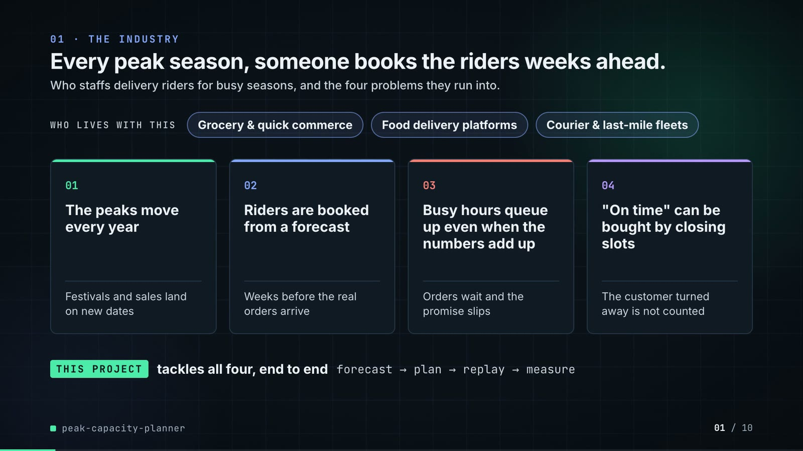

**On-screen text (verbatim)**

> 01 · THE INDUSTRY  
> Every peak season, someone books the riders weeks ahead.  
> Who staffs delivery riders for busy seasons, and the four problems they run into.  
> WHO LIVES WITH THIS · Grocery & quick commerce · Food delivery platforms · Courier & last-mile fleets  
> 01 The peaks move every year — Festivals and sales land on new dates  
> 02 Riders are booked from a forecast — Weeks before the real orders arrive  
> 03 Busy hours queue up even when the numbers add up — Orders wait and the promise slips  
> 04 "On time" can be bought by closing slots — The customer turned away is not counted  
> THIS PROJECT tackles all four, end to end · forecast → plan → replay → measure  

**Figures on this slide**

| ID | Shown | Source · key | Calculation | Check |
|---|---|---|---|---|
| F-01 | 3 industry chips | `author's framing` · - | - | manual |
| F-02 | 4 problem cards | `README 'The problem', 'Why it is hard'` · README lines 22-31 | - | ✓ |

**Assumptions:** A-13

**Illustrative, not data:**

- The whole slide is context; no repo figures.

**To change this slide:** Edit the chips (#ctx-c1..3) and cards (#ctx-k1..4) in compositions/s01-context.html. (project folder `docs/demo/source`).

### Slide 02: This project  
*6.8-12.0 s · composition `compositions/s02-hook.html`*

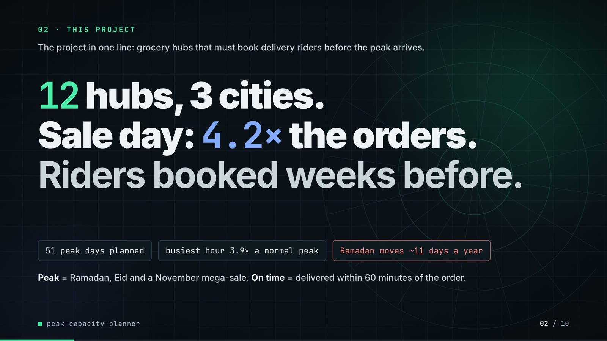

**On-screen text (verbatim)**

> 02 · THIS PROJECT  
> The project in one line: grocery hubs that must book delivery riders before the peak arrives.  
> 12 hubs, 3 cities. Sale day: 4.2× the orders. Riders booked weeks before.  
> 51 peak days planned · busiest hour 3.9× a normal peak · Ramadan moves ~11 days a year  
> Peak = Ramadan, Eid and a November mega-sale. On time = delivered within 60 minutes of the order.  

**Figures on this slide**

| ID | Shown | Source · key | Calculation | Check |
|---|---|---|---|---|
| F-03 | 12 hubs | `data/hubs.csv` · row count | - | ✓ |
| F-04 | 3 cities / 3 own-rider pools | `data/cities.csv` · row count | - | ✓ |
| F-05 | Sale day: 4.2× the orders | `data/hourly_orders.csv.gz` · orders on 2025-11-28 / mean Mon-Fri daily orders 2025-09-01..11-14 | 49,134 / 11,696 = 4.20 | ✓ |
| F-06 | On time = delivered within 60 minutes of the order / promise 60 min | `src/peak_capacity/config.py:17` · PROMISE_MINUTES | - | ✓ |
| F-07 | busiest hour 3.9× a normal peak | `data/hourly_orders.csv.gz` · max hourly orders 2025-11-28 / max over hours of the mean ordinary-weekday hourly orders | 3.87, rounded | ✓ |
| F-08 | Ramadan moves ~11 days a year | `src/peak_capacity/config.py:81-86 (RAMADAN)` · first-day dates 2023-2026 | mean shift between consecutive years = (12 + 10 + 11) / 3 = 11 days | ✓ |
| F-81 | 51 peak days planned | `results/hub_day.csv` · distinct date | - | ✓ |
| F-82 | Peak = Ramadan, Eid and a November mega-sale | `src/peak_capacity/config.py (WINDOWS); README 'The result'` · two windows | - | ✓ |

- *F-05 note:* Matches README 'The problem' (4.2 times). Ordinary-weekday window defined in A-11.
- *F-07 note:* Matches README 'The problem' (3.9 times a normal peak).

**Assumptions:** A-01, A-03, A-11, A-12

**Illustrative, not data:**

- Rings in the background are decoration.

**To change this slide:** Headline spans #hook-l1..l3 and chips #hook-f1..f3 in compositions/s02-hook.html; multiples are recomputed by the sale_multiple helper. (project folder `docs/demo/source`).

### Slide 03: How it works (white chapter, slide A)  
*11.7-19.7 s · composition `compositions/explainer.html (CONFIG.blocks, CONFIG.groups, CONFIG.loop)`*

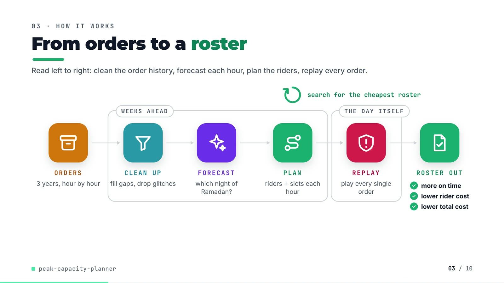

**On-screen text (verbatim)**

> 03 · HOW IT WORKS  
> From orders to a roster  
> Read left to right: clean the order history, forecast each hour, plan the riders, replay every order.  
> ORDERS 3 years, hour by hour → [WEEKS AHEAD: CLEAN UP fill gaps, drop glitches → FORECAST which night of Ramadan? → PLAN riders + slots each hour] → [THE DAY ITSELF: REPLAY play every single order] → ROSTER OUT ✓ more on time ✓ lower rider cost ✓ lower total cost  
> search for the cheapest roster (loop over PLAN)  

**Figures on this slide**

| ID | Shown | Source · key | Calculation | Check |
|---|---|---|---|---|
| F-09 | ✓ more on time ✓ lower rider cost ✓ lower total cost | `results/summary.json` · replay_otd, rider_cost, total_cost | mip_t99_d85 better than rule_of_thumb on all three | ✓ |
| F-10 | 3 years, hour by hour | `data/hourly_orders.csv.gz` · date years, op_hour | distinct years = 2023, 2024, 2025 | ✓ |

**Assumptions:** A-02, A-09

**Illustrative, not data:**

- Icons and colours are a visual language, not data.
- 'THE DAY ITSELF' = the replay plays each planned day against the true orders, after the fact.

**To change this slide:** Edit CONFIG in compositions/explainer.html; badge truth is F-09. (project folder `docs/demo/source`).

### Slide 04: The key idea (white chapter, slide B)  
*19.7-26.7 s · composition `compositions/explainer.html (#ex-b ...)`*

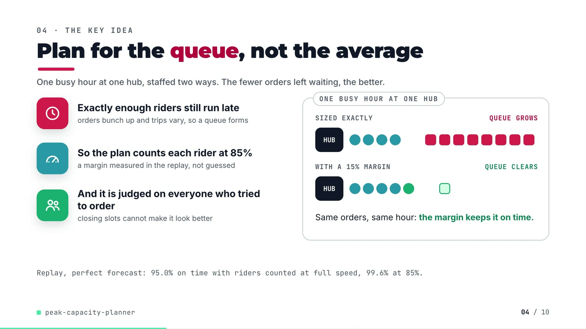

**On-screen text (verbatim)**

> 04 · THE KEY IDEA  
> Plan for the queue, not the average  
> One busy hour at one hub, staffed two ways. The fewer orders left waiting, the better.  
> Exactly enough riders still run late — orders bunch up and trips vary, so a queue forms  
> So the plan counts each rider at 85% — a margin measured in the replay, not guessed  
> And it is judged on everyone who tried to order — closing slots cannot make it look better  
> ONE BUSY HOUR AT ONE HUB: SIZED EXACTLY (4 riders) → QUEUE GROWS; WITH A 15% MARGIN (5 riders) → QUEUE CLEARS. Same orders, same hour: the margin keeps it on time.  
> Replay, perfect forecast: 95.0% on time with riders counted at full speed, 99.6% at 85%.  

**Figures on this slide**

| ID | Shown | Source · key | Calculation | Check |
|---|---|---|---|---|
| F-11 | 85% / 0.85 margin / margin 0.85 / 85% margin / riders at 85% | `src/peak_capacity/experiment.py:64` · Config('mip_t99_d85', ..., 0.85) | - | ✓ |
| F-12 | 95.0% | `results/plan_summary.csv` · config=mip_t99_d100_oracle, replay_otd | x 100, 1 dp | ✓ |
| F-13 | 99.6% | `results/plan_summary.csv` · config=mip_t99_d85_oracle, replay_otd | x 100, 1 dp | ✓ |
| F-14 | WITH A 15% MARGIN | `src/peak_capacity/experiment.py:64` · derate 0.85 | 1 - 0.85 = 15% | manual |

**Assumptions:** A-02, A-03, A-05

**Illustrative, not data:**

- The queue demo (4 vs 5 riders, 8 orders) is schematic; it mirrors README 'Where the plan-to-replay gap comes from', not a specific hub-hour.

**To change this slide:** Markup under #ex-b in compositions/explainer.html; the footnote figures are F-12 and F-13. (project folder `docs/demo/source`).

### Slide 05: Architecture  
*26.4-41.4 s · composition `compositions/s03-architecture.html`*

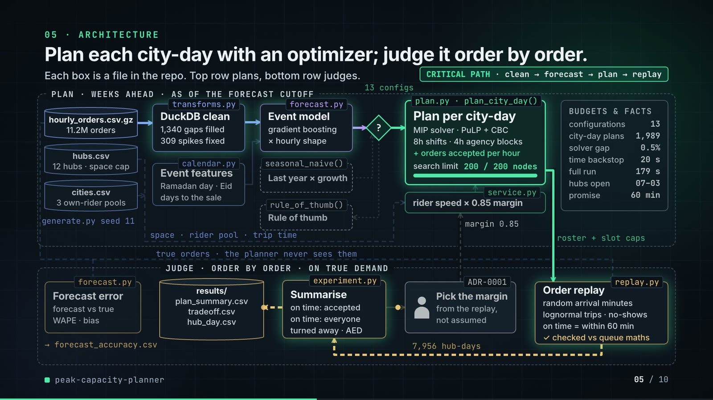

**On-screen text (verbatim)**

> 05 · ARCHITECTURE  
> Plan each city-day with an optimizer; judge it order by order.  
> Each box is a file in the repo. Top row plans, bottom row judges.  
> Legend: data · forecast · optimizer · scoring · person · in memory · file · baseline  
> PLAN · WEEKS AHEAD · AS OF THE FORECAST CUTOFF: generate.py seed 11 → hourly_orders.csv.gz (11.2M orders), hubs.csv (12 hubs · space cap), cities.csv (3 own-rider pools)  
> transforms.py DuckDB clean (1,340 gaps filled · 309 spikes fixed) · calendar.py Event features (Ramadan day · Eid · days to the sale)  
> forecast.py Event model (gradient boosting · × hourly shape) · seasonal_naive() Last year × growth (baseline)  
> decision ? (13 configs) → plan.py · plan_city_day() Plan per city-day (MIP solver · PuLP + CBC · 8h shifts · 4h agency blocks · + orders accepted per hour · search limit 200 / 200 nodes) | rule_of_thumb() (baseline)  
> service.py rider speed × 0.85 margin ← space · rider pool · trip time  
> BUDGETS & FACTS: configurations 13 · city-day plans 1,989 · solver gap 0.5% · time backstop 20 s · full run 179 s · hubs open 07–03 · promise 60 min  
> JUDGE · ORDER BY ORDER · ON TRUE DEMAND: true orders (the planner never sees them) → replay.py Order replay (random arrival minutes · lognormal trips · no-shows · on time = within 60 min · ✓ checked vs queue maths) ← roster + slot caps  
> 7,956 hub-days → experiment.py Summarise (on time: accepted · on time: everyone · turned away · AED) → results/ (plan_summary.csv, tradeoff.csv, hub_day.csv) and → ADR-0001 Pick the margin (from the replay, not assumed) → margin 0.85 (feedback)  
> forecast.py Forecast error (forecast vs true · WAPE · bias) → forecast_accuracy.csv  
> CRITICAL PATH · clean → forecast → plan → replay  

**Figures on this slide**

| ID | Shown | Source · key | Calculation | Check |
|---|---|---|---|---|
| F-03 | 12 hubs | `data/hubs.csv` · row count | - | ✓ |
| F-04 | 3 cities / 3 own-rider pools | `data/cities.csv` · row count | - | ✓ |
| F-06 | On time = delivered within 60 minutes of the order / promise 60 min | `src/peak_capacity/config.py:17` · PROMISE_MINUTES | - | ✓ |
| F-11 | 85% / 0.85 margin / margin 0.85 / 85% margin / riders at 85% | `src/peak_capacity/experiment.py:64` · Config('mip_t99_d85', ..., 0.85) | - | ✓ |
| F-15 | 11.2M orders | `data/hourly_orders.csv.gz` · sum(orders) | 11,198,428 / 1e6, 1 dp | ✓ |
| F-16 | generate.py seed 11 | `scripts/generate_data.py:14` · --seed default | - | ✓ |
| F-17 | 1,340 gaps filled | `results/cleaning.csv` · gaps_filled | - | ✓ |
| F-18 | 309 spikes fixed | `results/cleaning.csv` · spikes_replaced | - | ✓ |
| F-19 | gradient boosting | `src/peak_capacity/forecast.py:71-72` · HistGradientBoostingRegressor(loss='poisson') | - | ✓ |
| F-20 | 13 configs / configurations 13 | `results/plan_summary.csv` · row count | - | ✓ |
| F-21 | 1,989 | `results/run_log.txt` · 'solving 1989 city-day plans' | - | ✓ |
| F-22 | solver gap 0.5% | `src/peak_capacity/plan.py:129` · gapRel=0.005 | - | ✓ |
| F-23 | 200 / 200 nodes | `src/peak_capacity/plan.py:82` · max_nodes: int = 200 | - | ✓ |
| F-24 | time backstop 20 s | `src/peak_capacity/plan.py:83` · time_limit: int = 20 | - | ✓ |
| F-25 | full run 179 s / ~3 min | `results/run_log.txt` · '[  179.3s] done' | 179.3 s, rounded; ~3 min on slide 10 | ✓ |
| F-26 | hubs open 07–03 | `src/peak_capacity/config.py:14-15` · OPEN_CLOCK_HOUR = 7, N_HOURS = 20 | 07:00 + 20 h = 03:00 | ✓ |
| F-27 | 7,956 hub-days | `results/hub_day.csv` · row count | 13 configs x 612 hub-days | ✓ |
| F-28 | ✓ checked vs queue maths | `tests/test_replay.py:20` · test_dispatch_matches_erlang_c_waiting_probabilities | - | ✓ |
| F-29 | Pick the margin · from the replay, not assumed · margin 0.85 | `docs/adr/0001-plan-with-a-fluid-mip-judge-with-an-order-replay.md` · Decision bullet 4 | - | ✓ |
| F-30 | 8h shifts · 4h agency blocks | `src/peak_capacity/config.py:53, :55` · OWN_SHIFT_HOURS, GIG_BLOCK_HOURS | - | ✓ |
| F-31 | transforms.py, calendar.py, forecast.py, seasonal_naive(), rule_of_thumb(), plan.py · plan_city_day(), service.py, experiment.py, replay.py, generate.py | `src/peak_capacity/` · def names | - | ✓ |

- *F-18 note:* README: the three planted spikes are among them; the rest are high-noise hours the rule should have left alone.
- *F-23 note:* The node counter animates 0 -> 200 for illustration; the pace is not a measured solve time.
- *F-25 note:* README says 'about 2 min on a quiet machine'; the logged run took 179 s.

**Assumptions:** A-01, A-02, A-06, A-07, A-08

**Illustrative, not data:**

- Packets moving along the wires are decoration in execution order, not measured timings.
- The CBC node counter animates to its real limit (200); the pace is not a measured solve.
- 'Pick the margin' (the derate) is the decision recorded in ADR-0001 (one derate for the run), not an interactive step in the code.

**To change this slide:** Node boxes (#n-*), cylinders (CYL) and the wires object W in compositions/s03-architecture.html. (project folder `docs/demo/source`).

### Slide 06a: The system running: 51 replayed days  
*41.0-48.6 s · composition `compositions/s04-routes.html (SERIES block from tools/export_series.py)`*

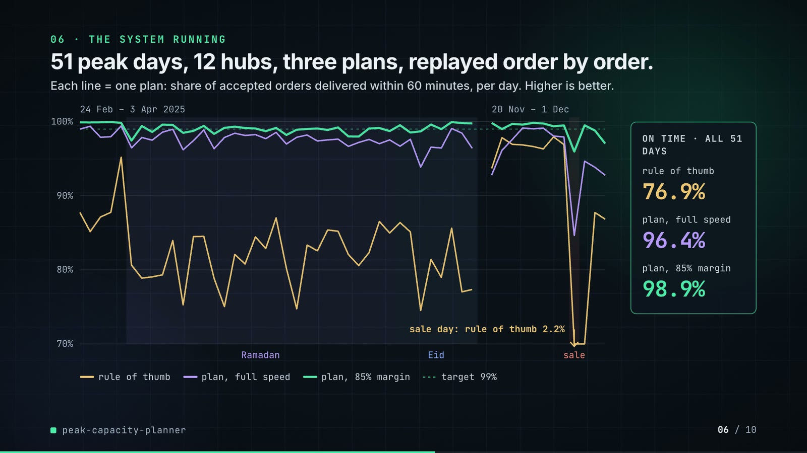

**On-screen text (verbatim)**

> 06 · THE SYSTEM RUNNING  
> 51 peak days, 12 hubs, three plans, replayed order by order.  
> Each line = one plan: share of accepted orders delivered within 60 minutes, per day. Higher is better.  
> legend (under the chart): rule of thumb · plan, full speed · plan, 85% margin · target 99%  
> Panels: 24 Feb – 3 Apr 2025 (Ramadan, Eid bands) | 20 Nov – 1 Dec (sale band); y axis 70%–100%  
> sale day: rule of thumb 2.2% (arrow: the line leaves the axis)  
> ON TIME · ALL 51 DAYS: rule of thumb 76.9% · plan, full speed 96.4% · plan, 85% margin 98.9%  

**Assumptions:** A-02, A-05, A-09

**Illustrative, not data:**

- Values below 70% are drawn at the axis floor; the arrow and label give the real sale-day value.

**To change this slide:** Regenerate assets/run_series.json with tools/export_series.py and inject it; styling in compositions/s04-routes.html. (project folder `docs/demo/source`).

### Slide 06b: The system running: the metric that disagrees  
*48.6-55.6 s · composition `compositions/s04-routes.html (#routes-dg)`*

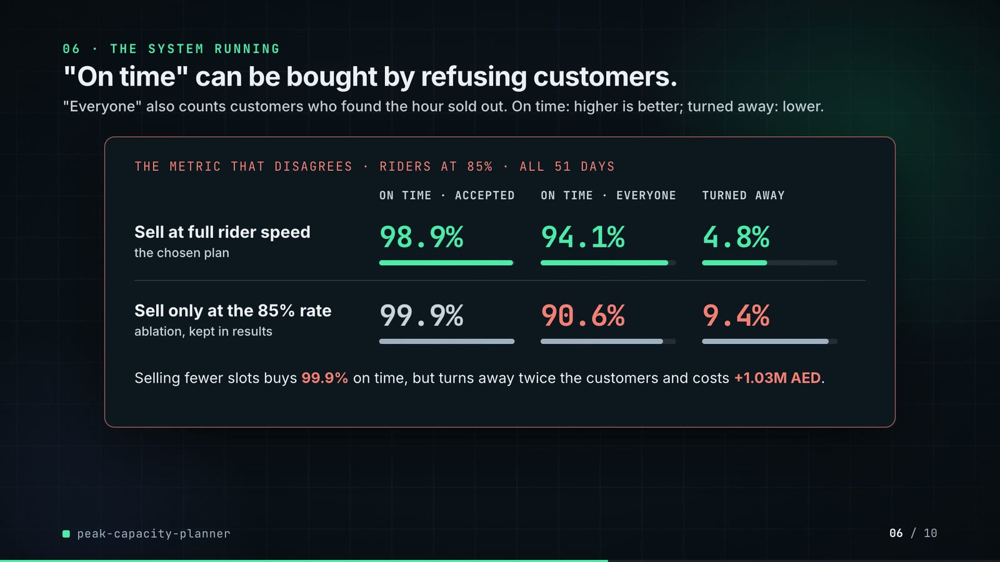

**On-screen text (verbatim)**

> "On time" can be bought by refusing customers.  
> "Everyone" also counts customers who found the hour sold out. On time: higher is better; turned away: lower.  
> THE METRIC THAT DISAGREES · RIDERS AT 85% · ALL 51 DAYS  
> columns: ON TIME · ACCEPTED | ON TIME · EVERYONE | TURNED AWAY  
> Sell at full rider speed (the chosen plan): 98.9% · 94.1% · 4.8%  
> Sell only at the 85% rate (ablation, kept in results): 99.9% · 90.6% · 9.4%  
> Selling fewer slots buys 99.9% on time, but turns away twice the customers and costs +1.03M AED.  

**Assumptions:** A-04, A-10

**Illustrative, not data:**

- Bar lengths: on-time bars on a 0-100% scale, turned-away bars on a 0-10% scale.

**To change this slide:** NAMES and the dg rows in compositions/s04-routes.html; values come from SERIES.disagree. (project folder `docs/demo/source`).

### Slide 07: End-user value (white)  
*55.3-68.3 s · composition `compositions/value.html (SHEET block from tools/export_roster.py)`*

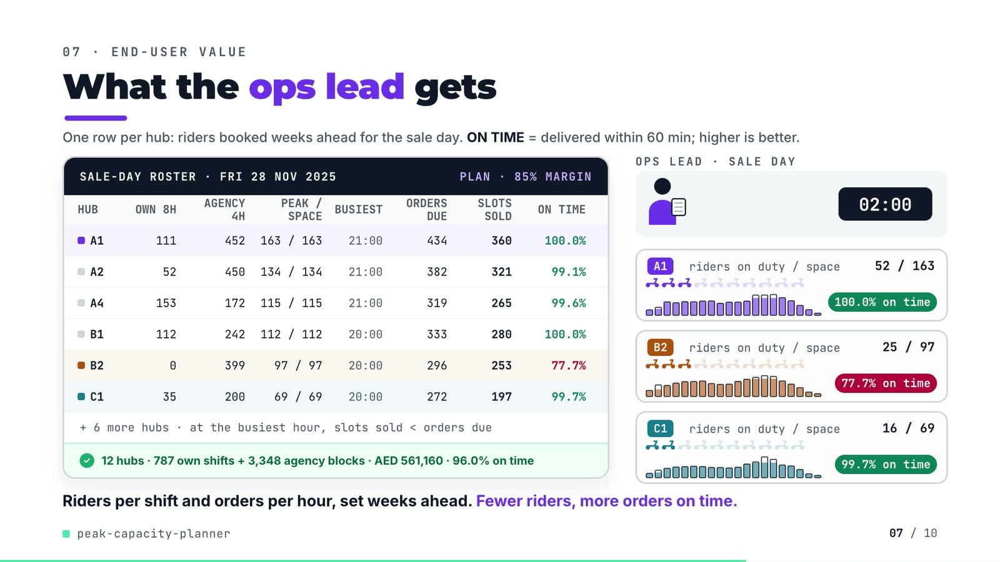

**On-screen text (verbatim)**

> 07 · END-USER VALUE  
> What the ops lead gets  
> One row per hub: riders booked weeks ahead for the sale day. ON TIME = delivered within 60 min; higher is better.  
> SALE-DAY ROSTER · FRI 28 NOV 2025 · PLAN · 85% MARGIN  
> HUB · OWN 8H · AGENCY 4H · PEAK / SPACE · BUSIEST · ORDERS DUE · SLOTS SOLD · ON TIME  
> A1 111 452 163/163 21:00 434 360 100.0% · A2 52 450 134/134 21:00 382 321 99.1% · A4 153 172 115/115 21:00 319 265 99.6% · B1 112 242 112/112 20:00 333 280 100.0% · B2 0 399 97/97 20:00 296 253 77.7% · C1 35 200 69/69 20:00 272 197 99.7%  
> + 6 more hubs · at the busiest hour, slots sold < orders due  
> 12 hubs · 787 own shifts + 3,348 agency blocks · AED 561,160 · 96.0% on time  
> Scene: OPS LEAD · SALE DAY, clock 07:00 → 02:00; hub cards A1, B2, C1 with riders on duty / space, hourly bars, badges 100.0% / 77.7% / 99.7% on time  
> Riders per shift and orders per hour, set weeks ahead. Fewer riders, more orders on time.  

**Figures on this slide**

| ID | Shown | Source · key | Calculation | Check |
|---|---|---|---|---|
| F-11 | 85% / 0.85 margin / margin 0.85 / 85% margin / riders at 85% | `src/peak_capacity/experiment.py:64` · Config('mip_t99_d85', ..., 0.85) | - | ✓ |
| F-49 | rows A1, A2, A4, B1, B2, C1 | `demo:assets/sale_day_roster.json -> value.html SHEET block` · own_riders, gig_total, peak_riders, max_on_duty, busiest_hour, busiest_forecast, busiest_slots, otd | - | ✓ |
| F-50 | the whole sheet | `tools/export_roster.py vs results/hub_day.csv (config mip_t99_d85, 2025-11-28)` · per hub | - | ✓ |
| F-51 | 787 own shifts | `results/hub_day.csv` · sum(own_riders), mip_t99_d85, sale_day | - | ✓ |
| F-52 | 3,348 agency blocks | `results/hub_day.csv` · sum(gig_blocks) | - | ✓ |
| F-53 | AED 561,160 | `results/hub_day.csv` · sum(rider_cost) | - | ✓ |
| F-54 | 96.0% on time | `results/hub_day.csv` · sum(on_time)/sum(accepted) | 43,782 / 45,628 = 95.954% -> 96.0% | ✓ |
| F-55 | FRI 28 NOV 2025 | `results/hub_day.csv` · segment=sale_day date | last Friday of November (config.mega_sale_day) | ✓ |
| F-56 | at the busiest hour, slots sold < orders due | `demo:assets/sale_day_roster.json` · busiest_slots < busiest_forecast for all 12 hubs | - | ✓ |
| F-57 | 77.7% | `results/hub_day.csv` · config=mip_t99_d85, date=2025-11-28, hub=B2 | on_time / accepted | ✓ |

- *F-54 note:* The README quotes 95.9% for the sale day; correct rounding of 95.954% is 96.0%.

**Assumptions:** A-02, A-04, A-06, A-10

**Illustrative, not data:**

- Scooter icons: 10 per hub = hub space; lit icons = riders on duty / space, rounded to tenths.
- Hourly bars: outline = forecast orders due, fill = orders the hour's slots can take (min of slots and forecast).
- The roster hand-off animation is decoration.
- 'Fewer riders' in the caption refers to rider cost vs the rule of thumb over the 51 days (F-58), not to this one day.

**To change this slide:** Re-run tools/export_roster.py, then tools/inject_sheet.py --marker SHEET (pick --rows / --animate); layout in compositions/value.html. (project folder `docs/demo/source`).

### Slide 08: Results  
*68.0-76.8 s · composition `compositions/s05-results.html`*

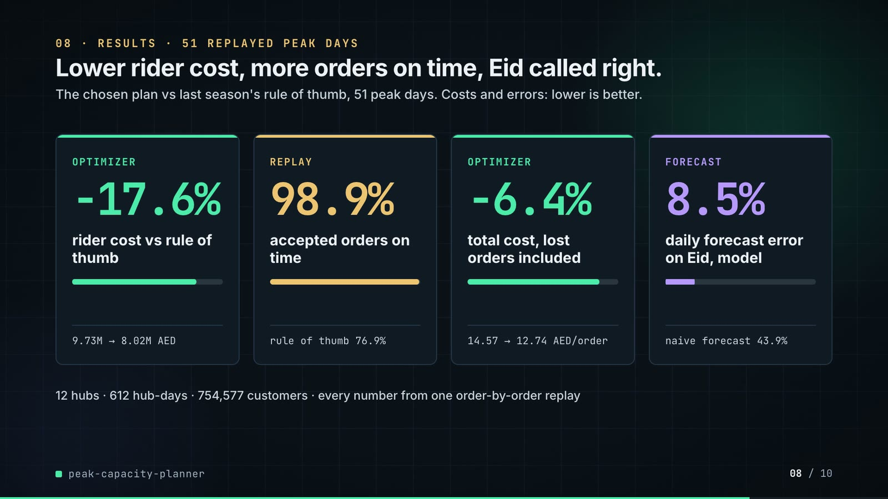

**On-screen text (verbatim)**

> 08 · RESULTS · 51 REPLAYED PEAK DAYS  
> Lower rider cost, more orders on time, Eid called right.  
> The chosen plan vs last season's rule of thumb, 51 peak days. Costs and errors: lower is better.  
> OPTIMIZER −17.6% rider cost vs rule of thumb · 9.73M → 8.02M AED  
> REPLAY 98.9% accepted orders on time · rule of thumb 76.9%  
> OPTIMIZER −6.4% total cost, lost orders included · 14.57 → 12.74 AED/order  
> FORECAST 8.5% daily forecast error on Eid, model · naive forecast 43.9%  
> 12 hubs · 612 hub-days · 754,577 customers · every number from one order-by-order replay  

**Figures on this slide**

| ID | Shown | Source · key | Calculation | Check |
|---|---|---|---|---|
| F-03 | 12 hubs | `data/hubs.csv` · row count | - | ✓ |
| F-36 | 76.9% | `results/plan_summary.csv` · config=rule_of_thumb, replay_otd | x 100 | ✓ |
| F-38 | 98.9% | `results/plan_summary.csv` · config=mip_t99_d85, replay_otd | x 100 | ✓ |
| F-58 | −17.6% | `results/plan_summary.csv` · rider_cost | 8,015,150 / 9,731,060 - 1 | ✓ |
| F-59 | 9.73M → 8.02M AED | `results/plan_summary.csv` · rider_cost | /1e6, 2 dp | ✓ |
| F-60 | 98.9% · rule of thumb 76.9% | `results/plan_summary.csv` · replay_otd | see F-36, F-38 | manual |
| F-61 | −6.4% | `results/plan_summary.csv` · total_cost | 9,107,180 / 9,731,060 - 1 | ✓ |
| F-62 | 14.57 → 12.74 AED/order | `results/plan_summary.csv` · cost_per_delivered | 2 dp | ✓ |
| F-63 | 8.5% | `results/forecast_accuracy.csv` · segment=eid, forecaster=model, daily_wape | x 100 | ✓ |
| F-64 | naive forecast 43.9% / 43.9% on Eid | `results/forecast_accuracy.csv` · segment=eid, forecaster=naive, daily_wape | x 100 | ✓ |
| F-65 | 612 hub-days | `results/plan_summary.csv` · hub_days | 12 hubs x 51 days | ✓ |
| F-66 | 754,577 customers | `results/hub_day.csv` · sum(demand) per config | - | ✓ |

**Assumptions:** A-02, A-04, A-08, A-09

**Illustrative, not data:**

- Mini bars show the ratio of the two values in each card's footer.

**To change this slide:** The stats array and footers in compositions/s05-results.html. (project folder `docs/demo/source`).

### Slide 09: Lesson and fix  
*76.4-85.8 s · composition `compositions/s06-twist.html`*

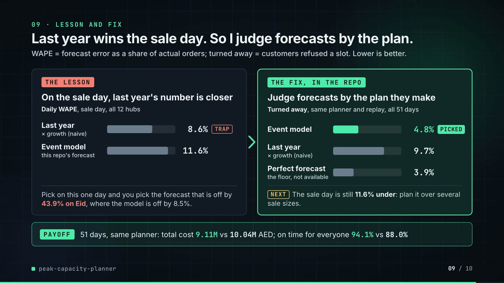

**On-screen text (verbatim)**

> 09 · LESSON AND FIX  
> Last year wins the sale day. So I judge forecasts by the plan.  
> WAPE = forecast error as a share of actual orders; turned away = customers refused a slot. Lower is better.  
> THE LESSON: On the sale day, last year's number is closer · Daily WAPE, sale day, all 12 hubs · Last year × growth (naive) 8.6% TRAP · Event model (this repo's forecast) 11.6%  
> Pick on this one day and you pick the forecast that is off by 43.9% on Eid, where the model is off by 8.5%.  
> THE FIX, IN THE REPO: Judge forecasts by the plan they make · Turned away, same planner and replay, all 51 days · Event model 4.8% PICKED · Last year × growth (naive) 9.7% · Perfect forecast (the floor, not available) 3.9%  
> NEXT The sale day is still 11.6% under: plan it over several sale sizes.  
> PAYOFF 51 days, same planner: total cost 9.11M vs 10.04M AED; on time for everyone 94.1% vs 88.0%  

**Figures on this slide**

| ID | Shown | Source · key | Calculation | Check |
|---|---|---|---|---|
| F-42 | 94.1% | `results/plan_summary.csv` · mip_t99_d85 served_on_time_share | x 100 | ✓ |
| F-43 | 4.8% | `results/plan_summary.csv` · mip_t99_d85 lost_share | x 100 | ✓ |
| F-63 | 8.5% | `results/forecast_accuracy.csv` · segment=eid, forecaster=model, daily_wape | x 100 | ✓ |
| F-64 | naive forecast 43.9% / 43.9% on Eid | `results/forecast_accuracy.csv` · segment=eid, forecaster=naive, daily_wape | x 100 | ✓ |
| F-67 | 8.6% (TRAP) | `results/forecast_accuracy.csv` · segment=sale_day, forecaster=naive | x 100 | ✓ |
| F-69 | 11.6% | `results/forecast_accuracy.csv` · segment=sale_day, forecaster=model | x 100 | ✓ |
| F-70 | still 11.6% under | `results/forecast_accuracy.csv` · segment=sale_day, forecaster=model, bias | x 100 (negative = under) | ✓ |
| F-75 | Judge forecasts by the plan they make · same planner and replay | `src/peak_capacity/experiment.py:71` · Config('mip_t99_d85_naive', 'naive', 'mip', 0.99, 0.85) | - | ✓ |
| F-76 | 9.7% | `results/plan_summary.csv` · mip_t99_d85_naive lost_share | x 100 | ✓ |
| F-77 | 3.9% (the floor, not available) | `results/plan_summary.csv` · mip_t99_d85_oracle lost_share | x 100 | ✓ |
| F-78 | 9.11M vs 10.04M AED | `results/plan_summary.csv` · total_cost | /1e6, 2 dp | ✓ |
| F-79 | 88.0% | `results/plan_summary.csv` · mip_t99_d85_naive served_on_time_share | x 100 | ✓ |
| F-80 | NEXT · plan it over several sale sizes | `README 'Known limitations' and 'Insights and learning'` · scenario-based plan over sale intensity | - | ✓ |

- *F-75 note:* Same target, margin and cap rule as the chosen plan mip_t99_d85; only the forecaster differs. tests/test_forecast.py:14 checks the event model beats the naive forecast on Ramadan's last ten nights and Eid.

**Assumptions:** A-02, A-04, A-05, A-08, A-10

**Illustrative, not data:**

- Bars in both panels share one scale: 20 px per percentage point (13% = the 260 px track). Left bars are daily WAPE, right bars are turned-away shares; both are percentages where lower is better.
- Grey = options being compared; mint = the picked forecast; coral only on the TRAP label; amber on NEXT (a next step the repo does not implement).

**To change this slide:** Panels and payoff strip in compositions/s06-twist.html; the fix is the mip_t99_d85_naive configuration in src/peak_capacity/experiment.py:71 (F-75). (project folder `docs/demo/source`).

### Slide 10: End card  
*85.4-89.8 s · composition `compositions/s07-end.html`*

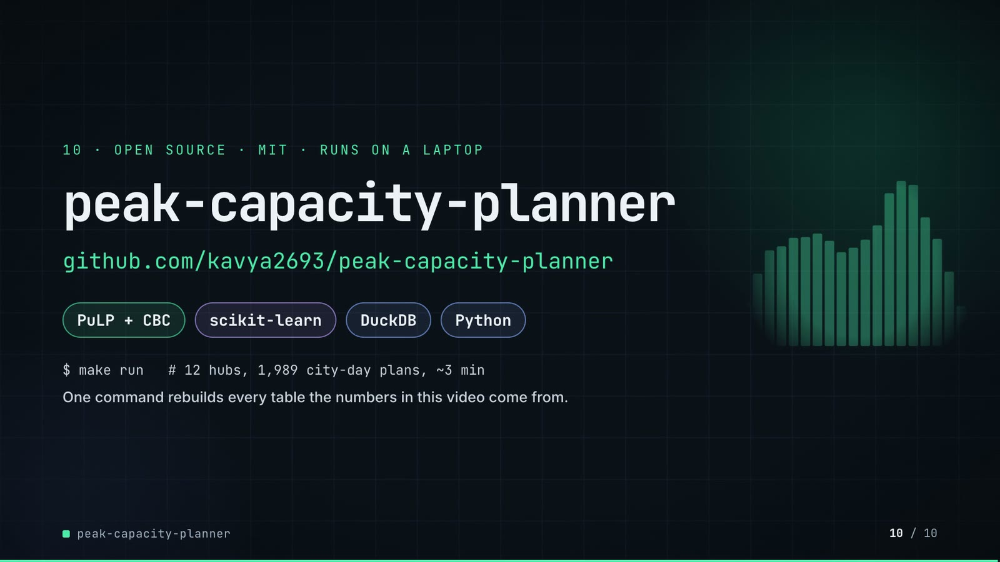

**On-screen text (verbatim)**

> 10 · OPEN SOURCE · MIT · RUNS ON A LAPTOP  
> peak-capacity-planner  
> github.com/kavya2693/peak-capacity-planner  
> PuLP + CBC · scikit-learn · DuckDB · Python  
> $ make run   # 12 hubs, 1,989 city-day plans, ~3 min  
> One command rebuilds every table the numbers in this video come from.  

**Figures on this slide**

| ID | Shown | Source · key | Calculation | Check |
|---|---|---|---|---|
| F-21 | 1,989 | `results/run_log.txt` · 'solving 1989 city-day plans' | - | ✓ |
| F-25 | full run 179 s / ~3 min | `results/run_log.txt` · '[  179.3s] done' | 179.3 s, rounded; ~3 min on slide 10 | ✓ |
| F-73 | PuLP + CBC · scikit-learn · DuckDB · Python · MIT | `pyproject.toml` · dependencies, license | - | ✓ |
| F-74 | faded bars | `demo:assets/sale_day_roster.json -> s07-end.html SALE block` · sum of hub forecasts per hour | - | ✓ |

- *F-25 note:* README says 'about 2 min on a quiet machine'; the logged run took 179 s.

**Assumptions:** A-12

**Illustrative, not data:**

- The faded bars are the sale day's network forecast per operating hour (F-74), used as a backdrop.

**To change this slide:** Text in compositions/s07-end.html; backdrop via inject_sheet.py --marker SALE. (project folder `docs/demo/source`).

## 5. Change-impact matrix

| Input / assumption | Affected figures | Affected slides | Files to edit | Commands to re-run |
|---|---|---|---|---|
| A-01: All data is synthetic, produced by a seeded generator sized to the production problem (12 hubs, 3 cities, 2023-2025 hourly orders, about 11 | all figures | 01, 02, 03, 04, 05, 06, 07, 08, 09, 10 | `src/peak_capacity/generate.py; src/peak_capacity/config.py (HUBS)` | `make data; make run; export_series.py + export_roster.py + inject_sheet.py` |
| A-02: Rider throughput is derated to 85% of the fluid rate (60 / trip minutes per rider-hour) for the chosen plan | F-11, F-12, F-13, F-14, F-29, F-36, F-37, F-38, F-41, F-42, F-43, F-44, F-45, F-46, F-47, F-48, F-50, F-51, F-52, F-53, F-54, F-58, F-59, F-61, F-62 | 04, 05, 06, 07, 08, 09 | `src/peak_capacity/experiment.py:64-74` | `make run; export_series.py + export_roster.py + inject_sheet.py` |
| A-03: Delivered on time = within 60 minutes of the order being placed; an order is ready 6 minutes after it is placed | F-06, F-12, F-13, F-36, F-37, F-38, F-39, F-41, F-42, F-44, F-45, F-50, F-54, F-58, F-60 | 02, 04, 05, 06, 07, 08, 09 | `src/peak_capacity/config.py:17-18` | `make run; export_series.py + export_roster.py + inject_sheet.py` |
| A-04: Rider economics in AED: own rider 160 per 8-hour shift, agency rider 130 per 4-hour block, a turned-away order costs 30 in lost margin | F-47, F-53, F-58, F-59, F-61, F-62 | 06, 07, 08 | `src/peak_capacity/config.py:53-57` | `make run; export_roster.py + inject_sheet.py` |
| A-05: Replay randomness: trips are lognormal around each hub's mean with CV 0 | F-12, F-13, F-36, F-37, F-38, F-39, F-41, F-42, F-43, F-44, F-45, F-46, F-48, F-50, F-54, F-58, F-60 | 04, 06, 07, 08, 09 | `src/peak_capacity/config.py:47-68` | `make run; export_series.py + export_roster.py + inject_sheet.py` |
| A-06: Hub space caps riders on duty at 3x the riders an ordinary weekday's busiest hour needs; own riders work 6 days in 7, drawn from a city pool | F-03, F-04, F-50, F-51, F-52, F-56 | 02, 05, 06, 07, 08 | `src/peak_capacity/config.py:71-75` | `make data; make run; export_roster.py + inject_sheet.py` |
| A-07: CBC stops at a 0 | F-22, F-23, F-24, F-50, F-58, F-59, F-61 | 05, 07, 08 | `src/peak_capacity/plan.py:82-83` | `make run` |
| A-08: Forecasts are made as of a cutoff (31 Jan 2025 for Ramadan, 31 Oct 2025 for the sale) with no data after it; the event model is gradient-boosted (Poisson) on the ratio to each hub's 28-day ordinary level | F-19, F-63, F-64, F-67, F-69, F-70, F-75, F-76, F-77, F-78, F-79 | 05, 08, 09 | `src/peak_capacity/config.py:112-115; src/peak_capacity/forecast.py` | `make run` |
| A-09: The rule of thumb sizes own riders to the day's forecast at 70% utilisation over three fixed shift starts, adds evening agency blocks, and never closes a slot | F-09, F-36, F-39, F-58, F-59, F-60, F-61, F-62 | 03, 06, 08 | `src/peak_capacity/plan.py:170` | `make run; export_series.py + inject_sheet.py` |
| A-10: Slots are sold up to the roster's flat-out rider throughput (cap rule 'fluid'); the derated-cap rule is kept as an ablation | F-41, F-42, F-43, F-44, F-45, F-46, F-47, F-48, F-56, F-75, F-76, F-77 | 06, 07, 09 | `src/peak_capacity/experiment.py:74` | `make run; export_series.py + inject_sheet.py` |
| A-11: 'Ordinary weekday' for the slide 02 multiples = Monday-Friday in the 10 weeks before the sale ramp (2025-09-01 | F-05, F-07 | 02 | `audit/facts.yaml helpers (sale_multiple)` | `build_audit_report.py` |
| A-12: Video rounding: percentages to 1 decimal, AED millions to 2 decimals, counts with thousands separators; '~11 days', '~3 min' and '11 | F-05, F-07, F-08, F-15, F-25, F-47, F-48, F-54, F-59, F-62, F-73 | 02, 05, 06, 07, 08, 10 | `the composition file named on each slide` | `hyperframes render` |
| A-13: Slide 01 (industries, everyday problems) is general delivery-operations knowledge used as context, not a result of this repo, and carries no numbers | F-01, F-02 | 01 | `compositions/s01-context.html` | `hyperframes render` |

## 6. Known differences and caveats

- Slide 09 drops the old 'what didn't win' detail now that it shows lesson and fix: the event model's sale-day bias against the naive forecast's (-11.6% vs -7.2%), its rest-of-sale-week WAPE (7.5%) and the 6 of 12 hubs below 99% on the sale day. All three are still in README 'The result' (forecast accuracy table and 'The sale day itself').
- Slide 09's fix does not repair the sale-day forecast: nothing in the plan hedges the sale (README 'Known limitations'). The slide labels the scenario-based sale plan as NEXT because the repo does not implement it.
- Sale-day on time: slide 07 shows 96.0% (43,782 / 45,628 = 95.954%, correctly rounded); README 'The sale day itself' says 95.9%.
- Full-run time: the logged make run took 179 s (results/run_log.txt); README 'Running it' says 'about 2 min on a quiet machine'. Slides use 179 s and ~3 min.
- The slide 02 multiples (4.2×, 3.9×) depend on the definition of an ordinary weekday (A-11); they match the README's figures.
- 'Rule of thumb 2.2%' on the sale day is a backlog that never clears in a replay with no cancellations; the README asks to read it as collapsed, not as a precise figure.
- All data is synthetic (A-01). Trip times are a per-hub mean with lognormal noise, not a road network; riders do not batch orders.
- The derate is one number for every hub and hour (README 'Known limitations'), and it was chosen from the replay that also scores the plans, so the chosen plan's on-time share is not an out-of-sample estimate.
- CBC can stop on its CPU backstop on a busy machine; README reports reruns differing by under 0.01% of cost in three configurations (A-07). The slide 07 re-run reproduced every sale-day hub exactly (F-50).
- Slide 01 statements are general industry knowledge (A-13).
- Hub names (A1...C3) and cities (A, B, C) are the repo's generic labels; no real places or people.

## Appendix: environment

- Commit: `e7248d751fba80345b2c28598d66cd4727f348b3`
- Python: 3.11.7
- pulp 3.3.2
- sklearn 1.9.1
- duckdb 1.5.6
- pandas 3.0.6
- numpy 2.4.6
- Profile / seeds: data_seed=11, replay_and_model_seed=0, workers=4
- Run time: results/run_log.txt: 'done' at 179.3 s for make run (4 workers) on the author's laptop
